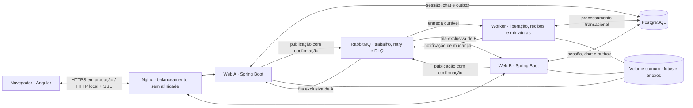
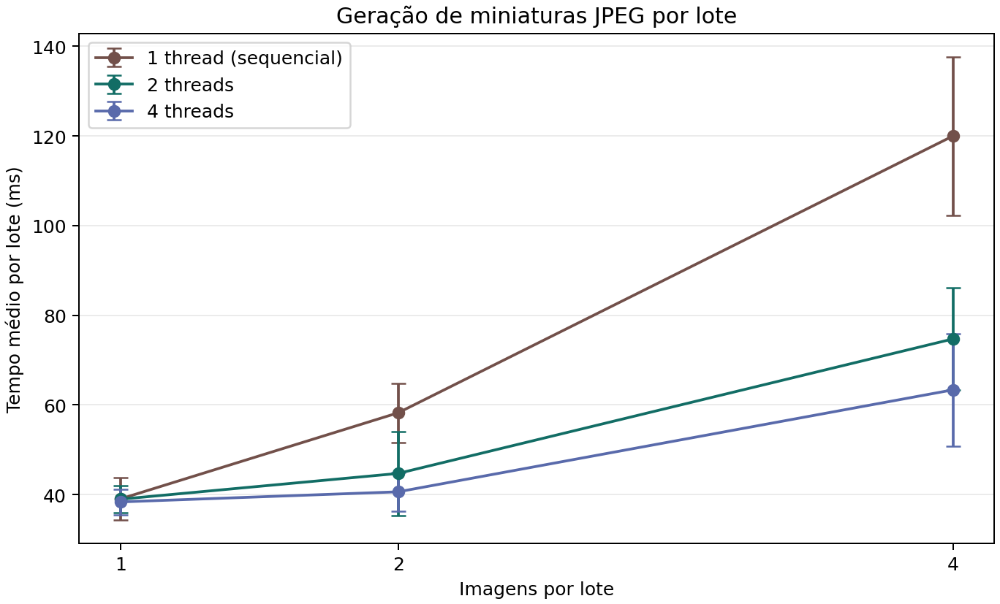

# Mensagens distribuídas · Receitopédia

## Como rodar

Execute na raiz com Java 17, Maven e o Docker com Compose em execução.

```bash
mvn clean install
docker compose up -d --wait
```

Acesse [http://localhost:8080](http://localhost:8080), entre com uma conta e abra **Mensagens**. Use duas contas em perfis separados do navegador para testar uma DM. Em **Criar grupo**, informe o nome do grupo e os nomes de usuário dos membros separados por vírgulas. A opção **Gerir grupo** oferece renomear, adicionar, promover, remover e sair conforme as permissões da conversa.

O alias `docker compose -f docker-compose-receitopedia.yml up` continua disponível. Use `RECEITOPEDIA_PORTA` e `RECEITOPEDIA_PORTA_POSTGRES` para mudar as portas locais. Para preparar a imagem a partir do JAR, também é possível usar `mvn clean verify` e o comando abaixo.

```bash
docker build -f deploy/Dockerfile.mensagens -t receitopedia-apresentacao-frontend:0.0.1-SNAPSHOT apresentacao-frontend/target
```

O administrador do grupo é um papel da conversa. Qualquer conta autenticada pode criar um grupo e se torna seu primeiro administrador. A promoção de administrador da plataforma continua usando `RECEITOPEDIA_ADMIN_EMAIL` com uma conta cadastrada e a recriação do serviço `receitopedia`, conforme as instruções já existentes do projeto.

## Arquitetura



- O Nginx distribui as requisições entre os dois nós e desativa o buffering para o SSE. O cabeçalho `X-Receitopedia-No` permite inspecionar o upstream. As réplicas processam HTTP e servem a mesma interface.
- O PostgreSQL mantém as sessões Spring Session JDBC, os dados do chat e o outbox. A mesma sessão funciona nas duas réplicas. Flyway aplica as tabelas novas. A execução local sem broker continua disponível para desenvolvimento e testes da API.
- O RabbitMQ separa o produtor do worker. O worker roda sem servidor HTTP e pode reiniciar sem interromper as requisições das réplicas. As três aplicações enxergam o mesmo volume de arquivos. A fila de notificações de cada réplica é exclusiva e temporária.
- O chat usa SSE porque os navegadores precisam receber eventos espontâneos do servidor e já enviam operações com HTTP autenticado e CSRF. Cada atualização contém a identificação da conversa, e o navegador consulta a API para recuperar o estado. A rota SSE exige sessão e cada notificação é enviada aos participantes ativos. O cliente reconecta e faz uma consulta periódica para convergir depois de uma desconexão.

O navegador gera o UUID e recebe HTTP 202 depois que a réplica grava a mensagem e o evento em uma transação. A mensagem fica visível para o autor como **Enviada**. Os processos ativos dividem a publicação das linhas pendentes com `SKIP LOCKED`. O publicador usa mensagens persistentes, exchange e filas duráveis, publisher confirms, publicação obrigatória e timeout. Se o broker estiver fora, a linha segue pendente. Se houver falha entre a confirmação no broker e o registro no outbox, o evento pode ser publicado novamente.

O worker processa o evento e persiste sua conclusão antes do ack manual. Uma mensagem se torna **Entregue** quando está disponível no histórico do destinatário. `evento_processado` e o UUID da mensagem impedem inserções em duplicidade. Erros no processamento passam por filas de retry de 1 s e 5 s. Na terceira falha, o evento vai para a DLQ. Execute o comando abaixo depois de corrigir a causa.

```bash
docker compose run --rm --no-deps \
  -e RECEITOPEDIA_EVENTOS_WORKER=false \
  -e RECEITOPEDIA_EVENTOS_REPROCESSAR=true worker
```

Reprocessar publica cada evento novamente com confirmação antes de removê-lo da DLQ. Os heartbeats e healthchecks sinalizam o estado dos serviços, e a política de restart reinicia processos que saem inesperadamente. A demonstração cobre a perda temporária do worker, de uma réplica e do broker. A pilha local usa uma instância de PostgreSQL, uma de RabbitMQ e um volume em um único host. A indisponibilidade do banco interrompe gravações até ele voltar. Para operar fora de uma máquina de demonstração, configure TLS, credenciais próprias e armazenamento acessível a todos os nós.

## Consistência e regras

| Dado | Modelo e justificativa |
| --- | --- |
| Mensagem e ordem por conversa | Forte no PostgreSQL. O lock da conversa serializa a atribuição da sequência. O worker libera em ordem, inclusive quando um evento posterior chega antes de um anterior. |
| Membros e administração | Forte. Alterações travam a conversa durante a validação e a gravação. Com 255 pessoas, duas entradas simultâneas deixam exatamente 256 no grupo. A última pessoa com papel de administrador precisa promover alguém antes de sair. |
| Bloqueio direto | Forte. O envio e as alterações do bloqueio usam o mesmo lock do par. A restrição vale nos dois sentidos e o bloqueio pode ser desfeito pelo autor. |
| Edição e exclusão | Forte. A versão otimista da mensagem gera HTTP 409 no conflito entre alterações concorrentes. A janela é de 15 minutos, exclusiva do autor. Após apagar, o histórico conserva apenas o marcador. |
| Recibos, não lidas e atualização da interface | Eventual. Recibos usam a chave mensagem/usuário e preservam o primeiro momento de leitura. No grupo, **Lida** exige a leitura de todos os membros ativos, exceto o autor. O recebimento da notificação só invalida a visualização, que busca o estado armazenado. |

A busca opera no texto da conversa autorizada, sem distinguir maiúsculas ou acentos. Ela usa parâmetros, escapa `%` e `_` e pagina pela sequência. Quem não participa recebe a mesma resposta que receberia para uma conversa inexistente. O chat aceita até quatro imagens JPEG, PNG ou WebP de 5 MB cada, verificadas pela assinatura e armazenadas com UUID. O download exige participação na conversa. Angular renderiza mensagens como texto. A miniatura de JPEG ou PNG usa o original como alternativa se não puder ser gerada. WebP é exibido a partir do próprio arquivo.

As regras estão em `dominio-comunicacao` e os casos de uso em `aplicacao/comunicacao`. As portas de persistência e publicação mantêm HTTP, PostgreSQL e RabbitMQ fora do domínio. A publicação e as filas de notificação seguem Observer em processos separados. O formato de evento com tipo, agregado e referência permite adicionar consumidores sem mudar a dependência do produtor. O cursor da API permite percorrer o histórico por páginas, com a mesma sequência usada na ordenação.

## Paralelismo e benchmark

O ponto paralelo é `ProcessadorImagens.gerar`. O worker decodifica, redimensiona e codifica cada imagem de um lote em tarefas independentes, com tamanho de pool configurável por `RECEITOPEDIA_THREADS_IMAGENS`. O padrão no Compose é 2. Use 1 para executar a mesma tarefa sequencialmente. O pipeline mantém a ordem dos anexos. A medição compara o custo completo dessa etapa para um lote em memória, em vez da latência total do chat.

Execute com Java 17 e Python com Matplotlib.

```bash
mvn verify
scripts/benchmark.sh /tmp/receitopedia-benchmark
```

O script usa o código de produção com quatro imagens determinísticas de 1.400 × 1.000 pixels, alternando JPEG e PNG. Os lotes têm 1, 2 ou 4 imagens e usam 1, 2 ou 4 threads. Cada cenário teve 3 lotes de aquecimento e 10 repetições, intercalados em ordem pseudoaleatória em uma única JVM. O ambiente tinha CPU AMD EPYC, quota de 2 CPUs para a JVM, 8 GiB de limite de memória e heap de 512 MiB. O Java rodou no host de teste, fora do Docker. O p95 usa o método do posto mais próximo e o desvio é amostral. [Ambiente](fccpd/ambiente.txt) · [Amostras](fccpd/amostras.csv) · [Resumo](fccpd/resumo.csv)

| Imagens | Threads | Média (ms) | Mediana (ms) | p95 (ms) | Desvio (ms) | Imagens/s | Ganho |
| ---: | ---: | ---: | ---: | ---: | ---: | ---: | ---: |
| 1 | 1 | 39,074 | 38,274 | 51,112 | 4,767 | 25,592 | 1,00× |
| 1 | 2 | 38,995 | 38,515 | 46,258 | 3,037 | 25,645 | 1,00× |
| 1 | 4 | 38,386 | 38,309 | 44,206 | 2,827 | 26,051 | 1,02× |
| 2 | 1 | 58,247 | 56,395 | 74,267 | 6,616 | 34,336 | 1,00× |
| 2 | 2 | 44,736 | 40,431 | 68,681 | 9,334 | 44,707 | 1,30× |
| 2 | 4 | 40,638 | 39,740 | 48,858 | 4,363 | 49,215 | 1,43× |
| 4 | 1 | 119,959 | 112,971 | 157,614 | 17,701 | 33,345 | 1,00× |
| 4 | 2 | 74,717 | 74,516 | 99,573 | 11,387 | 53,535 | 1,61× |
| 4 | 4 | 63,367 | 61,977 | 91,817 | 12,587 | 63,125 | 1,89× |



Com quatro imagens, o ganho médio foi 1,89× e o p95 caiu de 158 para 92 ms. Com uma imagem há apenas uma tarefa e o ganho observado foi pequeno em relação à variação. A quota de duas CPUs, a diferença de custo entre PNG e JPEG e o despacho e espera do pool limitam a escala. Pela Lei de Amdahl, o trecho serial do lote impõe um limite adicional. A medição isola a etapa intensiva em CPU e não inclui rede, disco, PostgreSQL ou RabbitMQ. Ela mede a contribuição dessa etapa, sem extrapolar o ganho para a aplicação inteira.

## Demonstração e testes

- `scripts/demo-consistencia.sh` executa os quatro cenários concorrentes da suíte com threads reais. Para usar o PostgreSQL, aponte `CHAT_TEST_DB_URL`, `CHAT_TEST_DB_USER` e `CHAT_TEST_DB_PASSWORD` para um banco descartável. [Registro do teste concorrente](fccpd/consistencia.txt)
- `FCCPD_LOGS=/tmp/receitopedia-falhas scripts/demo-falha.sh --base http://localhost:8080` cria contas de teste, faz envios contínuos e interrompe temporariamente worker, réplica web e RabbitMQ. Use em um projeto Compose de teste com a DLQ vazia. Ao final, o script também provoca uma falha de processamento, verifica retry e DLQ, reenvia o evento e testa idempotência. O diretório definido em `FCCPD_LOGS` recebe o relatório e os logs dos serviços.

No ensaio registrado, as três paradas ocorreram durante o envio pelo Nginx. O desligamento do worker deixou 7 eventos na fila. A interrupção do RabbitMQ deixou 8 eventos no outbox. O destinatário recebeu as 9 mensagens de cada cenário após a recuperação, totalizando 27, sem duplicatas. Uma falha de processamento adicional chegou à DLQ após três tentativas. O reprocessamento entregou a mensagem, e uma republicação do mesmo evento manteve uma mensagem e um recibo. [Registro da demonstração](fccpd/demo-falha.log) · [Trechos dos logs dos serviços](fccpd/servicos-falha.txt)

O ensaio usou os seis serviços do Compose e a mesma aplicação empacotada, em dois nós web e um worker. Como o Docker da máquina de teste usa VFS e ficou sem espaço ao copiar a imagem padrão para os três contêineres, o ensaio montou o JAR e o Temurin Alpine em um runtime compacto e usou a variante Alpine do PostgreSQL 18. Para o teste independente de entrega entre réplicas, foram expostas duas portas locais temporariamente. A sessão criada na réplica A funcionou na B e a SSE da réplica B recebeu a atualização de uma mensagem enviada pela A. [Registro das réplicas](fccpd/replicas.txt)

A suíte completa passou com H2 e com PostgreSQL. O teste no Chromium passou pelo cadastro, login, envio e leitura de DM, busca, edição, exclusão, gestão de grupo e visualização de miniatura no destinatário. [Registro do navegador](fccpd/navegador.txt)
